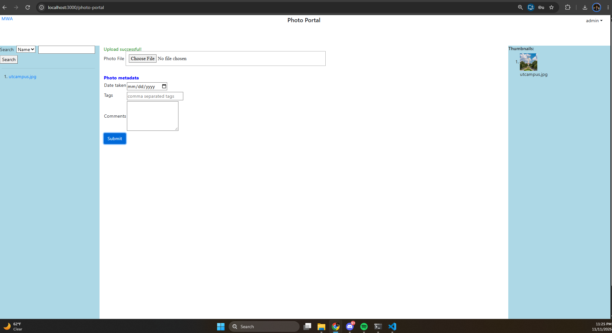
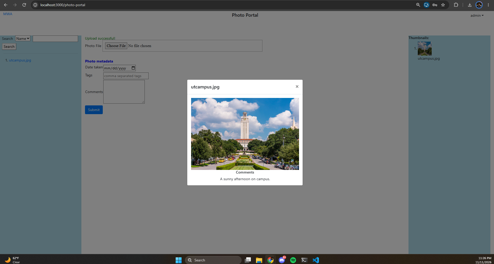
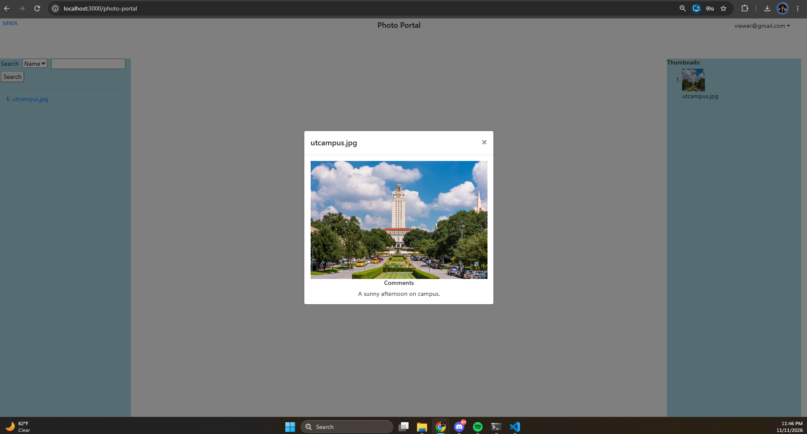

# Assignment 4 Reflection

A challenging requirement was separating admin and general-user access while allowing both types of users to view the same photo collection. Hiding the upload form in React was only one part of the implementation because a general user could otherwise send an upload request directly to the backend. To address this, Flask stores the authenticated user’s role in the session and checks it before accepting an upload. React also retrieves the current session before deciding whether to display the upload form. Logout clears the session and returns the user to the appropriate login page.

One complete data flow starts when the admin uploads a photo. React collects the selected image, date taken, tags, and comments into a FormData object and sends it to POST /api/upload. Flask retrieves these values, validates the image and date, and saves the image file. SQLAlchemy then stores the photo’s name, date, tags, and comments in the SQLite database. After the upload succeeds, React requests GET /api/photos and updates the photo collection using the returned metadata. When a thumbnail is clicked, React requests GET /api/photos/<photo_name>/comments. Flask queries the database for that photo and returns its comments, which appear in the modal.

For manual testing, I logged in as the admin and uploaded utcampus.jpg with a date, tags, and a comment. I confirmed that the upload succeeded and that the photo appeared in the collection. I then clicked the thumbnail and verified that the modal displayed the saved comment, “A sunny afternoon on campus.” I also registered viewer@gmail.com through the API and received a successful creation response. These checks covered the upload and comment retrieval workflow and confirmed that the general-user registration endpoint accepted a Gmail address.

## Screenshot evidence

**Requirements 3.2 and 3.5:** The admin successfully uploaded utcampus.jpg using the form that accepts a date, tags, and comments. The page displays an upload-success message and the photo’s thumbnail.

**Requirement 3.6:** Clicking the thumbnail opens a modal displaying the saved comment, “A sunny afternoon on campus.”

**General-user access requirement:** A registered Gmail user can view the admin’s uploaded photos without seeing the upload form.
